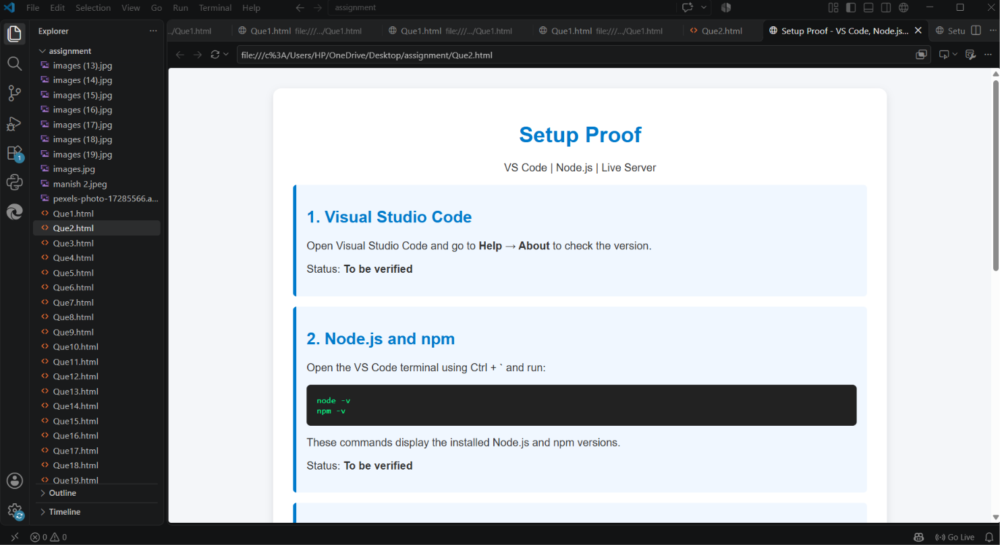

<!DOCTYPE html>
<html lang="en">
<head>
    <meta charset="UTF-8">
    <meta name="viewport" content="width=device-width, initial-scale=1.0">
    <title>Setup Proof - VS Code, Node.js & Live Server</title>

    
</head>

<body>
    

        <h1>Setup Proof</h1>
        

            VS Code | Node.js | Live Server
        

        

            <h2>1. Visual Studio Code</h2>
            

                Open Visual Studio Code and go to
                <strong>Help → About</strong> to check the version.
            

            
Status: <strong>To be verified</strong>

        

        

            <h2>2. Node.js and npm</h2>
            
Open the VS Code terminal using Ctrl + ` and run:

            <pre>node -v
npm -v</pre>
            

                These commands display the installed Node.js and npm
                versions.
            

            
Status: <strong>To be verified</strong>

        

        

            <h2>3. Live Server Extension</h2>
            

                Press Ctrl + Shift + X, search for
                <strong>Live Server by Ritwick Dey</strong>,
                and install the extension.
            

            

                Open an HTML file and click
                <strong>Go Live</strong> in the VS Code status bar.
            

            
Status: <strong>To be verified</strong>

        

        

            <h2>4. Browser Verification</h2>
            

                The browser should open your local webpage at an address
                similar to:
            

            

                <code>http://127.0.0.1:5500/</code>
            

            
Status: <strong>To be verified</strong>

        

        

            <h2>Setup Screenshot</h2>
            

                Save your actual screenshot at:
            

            <code>screenshots/setup-proof.png</code>

            

                The screenshot should show VS Code, terminal output,
                the Live Server extension, and the browser.
            

            

            

                Screenshot not found. Save your screenshot in the
                screenshots folder using the filename setup-proof.png.
            

        

        

            <strong>Note:</strong> The setup status is not automatically
            verified by this page. Capture a screenshot from your actual
            computer to provide genuine setup proof.
        

        <footer>
            Setup Proof | VS Code, Node.js & Live Server
        </footer>

    

</body>
</html>
